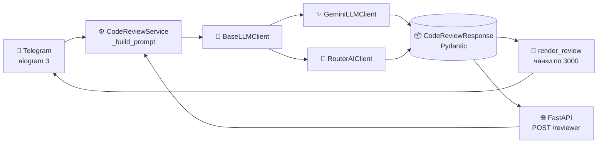

# 🤖 AI Telegram Reviewer

<div align="center">


**Telegram-бот + REST API для AI-ревью Python-кода: уровни Junior / Middle / Senior, выбор провайдера, тул-коллинг с ruff**

</div>

---

## ✨ Что умеет

|     |                                                                                                                                                                            |
| --- | -------------------------------------------------------------------------------------------------------------------------------------------------------------------------- |
| 🎯  | **Три уровня строгости** — Junior ловит баги и безопасность, Middle добавляет типы и архитектуру, Senior проверяет race conditions и масштабируемость                      |
| 🔌  | **Два провайдера на выбор юзера** — ✨ Gemini бесплатно на серверном ключе или 🔀 RouterAI на своём ключе: ввод ключа через бот (FSM), 3 дешёвые модели с ценами в кнопках |
| 🔧  | **Тул-коллинг с ruff** — модель вызывает линтер перед ответом (Gemini function calling + OpenAI tools), факты вместо фантазий; «не код» отличает от бага                   |
| 📦  | **Строгий structured output** — модель обязана вернуть валидный JSON, который валидируется Pydantic (`extra="forbid"`)                                                     |
| 🛡️  | **Защита от инъекций** — код обёрнут в `<code_to_review>`, промпт запрещает выполнять инструкции из кода                                                                   |
| 💰  | **Экономия денег** — лимит 8000 символов, кулдаун 10 сек на юзера, синглтон клиентов, группировка ответов                                                                  |
| 🔁  | **Два входа — одна логика** — Telegram-бот (polling) и FastAPI (`POST /reviewer`) делят `CodeReviewService`                                                                |

---

## 💬 Как это выглядит

<table>
<tr>
<td width="50%">

**👤 Пользователь выбирает уровень**

```
┌─────────────────────────┐
│  Привет! Пришли         │
│  Python-код, и я        │
│  сделаю AI-ревью.       │
│                         │
│  [Junior] [Middle]      │
│  [Senior]               │
└─────────────────────────┘
```

**👤 Присылает код**

```python
def get_user(uid):
    q = f"SELECT * FROM users WHERE id={uid}"
    return db.execute(q).fetchone()
```

</td>
<td width="50%">

**🤖 Бот отвечает**

> 🔍 **AI CODE REVIEW**
> 🎯 Уровень: Middle
> 📊 Оценка: **42/100**
> 🟩🟩🟩🟩⬜⬜⬜⬜⬜⬜
>
> 📝 Итог
> SQL-инъекция через f-строку, нет обработки отсутствующего пользователя.
>
> 🟠 **Проблема #1**
> 📌 SQL-инъекция
> ⚡ Серьёзность: Высокая
> 🏷 Категория: security
> 📍 Строка: 2
> 💡 Замени на параметризованный запрос
>
> 🛠 **Улучшенный код**
>
> ```python
> def get_user(uid: int):
>     row = db.execute(
>         "SELECT * FROM users WHERE id=?",
>         (uid,),
>     ).fetchone()
>     if row is None:
>         raise UserNotFound(uid)
>     return row
> ```
>
> 📚 Объяснение · 🚀 Задание для практики ⬇️

</td>
</tr>
</table>

---

## 🏗 Архитектура



**Поток:** пользователь → уровень + провайдер + код → шаблон `app/prompts/review.txt` → тул-коллинг `run_ruff` → LLM → валидация JSON → рендер в HTML-сообщения Telegram.

### Модели RouterAI на выбор

| Модель                                            | Вход / 1M | Выход / 1M |
| ------------------------------------------------- | --------- | ---------- |
| Qwen 3.7 Flash (`qwen/qwen3.7-flash`)             | 3.14₽     | 13₽        |
| Ling 3.0 Flash (`inclusionai/ling-3.0-flash`)     | 2.20₽     | 6₽         |
| MiniMax M3.1 Flash (`minimax/minimax-m3.1-flash`) | 9₽        | 52₽        |

```
ai-telegram-reviewer/
├── bot.py                  # Telegram: reply-клавиатура, FSM провайдера, лимиты, троттлинг
├── utils.py                # Рендер ревью в сообщения (группировка по 3, чанки кода)
├── app/
│   ├── main.py             # FastAPI: POST /reviewer (502 при ошибке LLM), lifespan
│   ├── config.py           # pydantic-settings + fail-fast проверка ключей
│   ├── deps.py             # Кеш клиентов (общий Gemini, RouterAI по связке ключ+модель)
│   ├── schemas.py          # CodeReviewResponse, severity, score 0-100
│   ├── prompts/review.txt  # Промпт отдельно от кода
│   ├── services/code_review.py
│   ├── tools/ruff_tool.py  # Инструмент run_ruff + декларации для обоих провайдеров
│   └── llm/                # base + gemini (tools) + routerai (tools)
├── tests/                  # 7 тестов
├── Dockerfile
└── requirements.txt        # 11 прямых зависимостей
```

---

## 🚀 Запуск за 3 минуты

### Вариант 1 — локально

```bash
python -m venv venv && source venv/bin/activate
pip install -r requirements.txt
cp .env.example .env   # впиши ключи
python bot.py          # бот
# или API:
uvicorn app.main:app --reload
```

### Вариант 2 — Docker

```bash
cp .env.example .env   # впиши ключи
docker build -t ai-reviewer .
docker run --env-file .env ai-reviewer
```

### Переменные окружения

| Переменная           | Что это                                                                               | Обязательно |
| -------------------- | ------------------------------------------------------------------------------------- | ----------- |
| `LLM_PROVIDER`       | `gemini` или `routerai`, дефолт для API и новых юзеров (в боте переключается кнопкой) | да          |
| `GEMINI_API_KEY`     | общий ключ Gemini для всех юзеров бота                                                | да*         |
| `GEMINI_MODEL`       | например `gemini-2.5-flash`                                                           | нет         |
| `ROUTERAI_API_KEY`   | серверный ключ для API; в боте каждый вводит свой через «⚙️ Провайдер»                | да*         |
| `ROUTERAI_MODEL`     | дефолтная модель API (`qwen/qwen3.7-flash` — 3.14₽/13₽ за 1M)                         | нет         |
| `TELEGRAM_BOT_TOKEN` | токен от [@BotFather](https://t.me/BotFather)                                         | да          |

> Конфиг падает сразу при старте с понятным текстом, а не глубоко внутри SDK.

---

## ✅ Тесты и линтер

```bash
pytest -q          # 7 тестов: промпт, группировка, конфиг, 502, изоляция провайдеров
ruff check bot.py utils.py app/ tests/
```

| Тест                                          | Что проверяет                                          |
| --------------------------------------------- | ------------------------------------------------------ |
| `test_prompt_keeps_braces_and_replaces_level` | код с `{}` не ломает шаблон, уровень подставлен        |
| `test_prompt_has_no_curly_quotes`             | нет «ёлочных» кавычек — LLM не скопирует битый JSON    |
| `test_render_groups_issues_by_three`          | 7 проблем → 3 сообщения, без `FloodWait`               |
| `test_config_requires_key_for_provider`       | без ключа — понятная ошибка при старте                 |
| `test_reviewer_maps_runtime_error_to_502`     | ошибка LLM → `502`, а не голый `500`                   |
| `test_router_clients_separated_by_key`        | разные ключи — разные клиенты, чужие деньги не трогаем |
| `test_gemini_client_is_singleton`             | общий клиент переиспользуется, сессий не течёт         |

---

## 🧠 Ключевые решения

- **Промпт — данные, а не f-строка.** Лежит в `review.txt`, подстановка через `replace` — код с `{...}` и f-строками не ломает шаблон.
- **Тул-коллинг без доверия модели.** `run_ruff` выполняется на коде из чата (аргументы модели игнорируются), только задекларированные имена, первый запрос без JSON-режима — иначе Gemini отвечает в обход инструмента.
- **Ключи юзеров изолированы.** Кеш RouterAI по связке модель+ключ, в чат и логи — только `...abcd`.
- **Один клиент на всё время жизни.** `deps.py` кеширует `genai.Client` / `AsyncOpenAI`, `lifespan` и `finally` закрывают сессии — нет висящих сокетов.
- **Ошибки в один `RuntimeError`.** Оба клиента заворачивают `APIError` и `ValidationError`, бот показывает текст человеку, API отдаёт `502` с `detail`.
- **Telegram-специфика:** `html.escape` везде, нарезка по 3000 символов под лимит Bot API, `monotonic()` для кулдауна.

## 🗺 Дальше

- [ ] Ретраи через `tenacity` на `APIError` / `RateLimit`
- [ ] Стриминг ответа («печатает...» вместо «Начинаю ревью...»)
- [ ] Подсчёт токенов и лимит стоимости на юзера
- [ ] Redis вместо `dict` в памяти (см. `TODO` в `bot.py`)
- [ ] Мини-эвал: 5 эталонных кусков кода → ожидаемый `severity`

---

<div align="center">

Сделано в учебных целях: интеграция LLM + Telegram-боты (aiogram 3, FastAPI, structured output, Docker).

</div>
